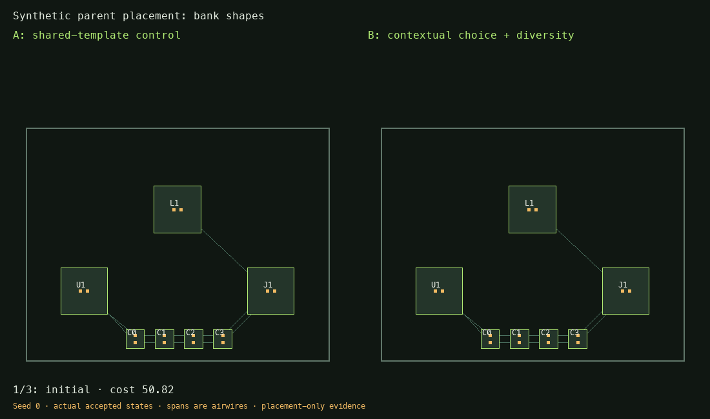

# Contextual block layout selection

The legacy hierarchy samples one layout per template before parent placement;
all instances of that template share it. The contextual selector permits each
instance to change its internal layout in response to its parent context.

## Methods and controls

`PNR_HIER_LAYOUT_SEARCH` defaults to `alternating`; `off` restores the legacy path.
Geometric diversity also defaults on (`PNR_HIER_LAYOUT_DIVERSE=0` disables it).
See [combined default validation](pr100-defaults.md).

| Method        | Change                                                       |
| ------------- | ------------------------------------------------------------ |
| `independent` | Seeded library draw for each instance independently          |
| `frozen`      | Try other internal layouts with parent poses held fixed      |
| `alternating` | Try layout swaps with warm parent placement and legalization |
| `paired`      | Also try simultaneous two-block swaps                        |

`PNR_HIER_LAYOUT_DIVERSE=1` changes bounded candidate selection from the first
ranked records to farthest-first selection by shape and relative member poses.
The best eligible rank is retained. Native library files are not rewritten.
This preserves alternatives within the existing library; it cannot recover
layouts discarded earlier by a synthesis budget.

Python callers may supply `LayoutSearch(method=..., rounds=3,
max_evaluations=96, variants=6, relax_iters=60, diverse=True, score="objective")`
to `hierarchical_place(..., layout_search=...)`. Budgets bound evaluated proposals,
rounds and optimization steps. The surrounding campaign bounds wall time.

Each relaxed round also tries the incumbent layout with the same additional
optimization budget, separating further position optimization from a layout swap.
Only strict, whole-parent improvements are accepted, after independent expanded
placement and macro-clearance checks. Each proposal is rebuilt from immutable
source inputs. Failed proposals leave the incumbent unchanged. Libraries' native
failure counters cannot be traded for cheaper parent geometry.

The default score is the existing rigid-pose global objective, including authored
constraints and enabled pad locality; optional routing-feedback pair weights are
added. `score="hpwl"` is a wirelength ablation. With `PNR_POWER_FIRST=1`, the
environment-selected configuration uses `score="power"`, the existing power-path
placement score. This is not a routed inductance or congestion model.

Records include seed, configuration, source/library hashes, individual selected
record hashes, all evaluated scores/rejections, and actual accepted placement
frames. Each instance retains its own selected native-board path. Downstream
assembly uses those selected block boards; parent copper must be regenerated and
validated. No previous parent routing result is transferred to a variant swap.

## Synthetic experiment

`python -m regression.layout_choice_study --out RESULTS --seeds 0 1 2`
runs all six study arms on four synthetic cases using 120 initial iterations,
60-step relaxed proposals, a 96-evaluation ceiling and a 180-second worker bound.
All variants describe explicit local geometry; these fixtures are placement
experiments, not native-electrically-qualified circuits.

- Opposed ports: repeated instances require different internal pin ordering.
- Bank shapes: a capacitor bank has square, row and column arrangements.
- Coupled ports: changes affect inter-block wiring and fixed external interfaces.
- Crowded library: nearly identical high-ranked records consume a small shortlist.

The retained result table and artifact hashes are in
[the study manifest](assets/mini-pad-locality/layout-choice-study.json).
The animation uses actual accepted states, without interpolated placements:

All 72 placements pass the independent placement checks. Mean whole-parent
objective over seeds 0, 1 and 2 (lower is better):

| Case            | Control | Independent | Frozen | Alternating | Diverse | Paired |
| --------------- | ------: | ----------: | -----: | ----------: | ------: | -----: |
| Bank shapes     |   48.99 |       48.99 |  48.99 |       45.23 |   45.23 |  45.23 |
| Coupled ports   |   60.57 |       60.25 |  57.07 |       56.89 |   56.89 |  56.89 |
| Crowded library |  102.55 |      102.55 |  93.30 |       99.46 |   93.32 |  93.32 |
| Opposed ports   |  102.55 |       99.48 |  93.32 |       93.32 |   93.32 |  93.32 |

The arms perform different amounts of work; this is not an equal-compute claim.
Alternating and diverse arms have the same two-record shortlist budget. Frozen
uses six records. Full per-candidate times and evaluations are retained.

Alternating parent relaxation improves bank placement where fixed-pose swaps
cannot. Independent sampling alone is inconsistent. Diversity helps the crowded
library case; the paired-swap arm has no additional benefit on these cases.
These results justify further routing experiments, not enabling a new default.

This change operates at an existing hierarchy boundary. It does not introduce
recursive source partitioning, synthesize capacitor layouts automatically, or
prove global optimality. A bank must have an authored block/library to participate
in this selector; the separate placement-bank compactness feature is not such a
routed library.
