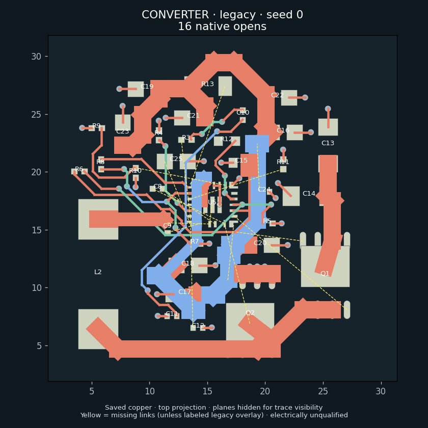
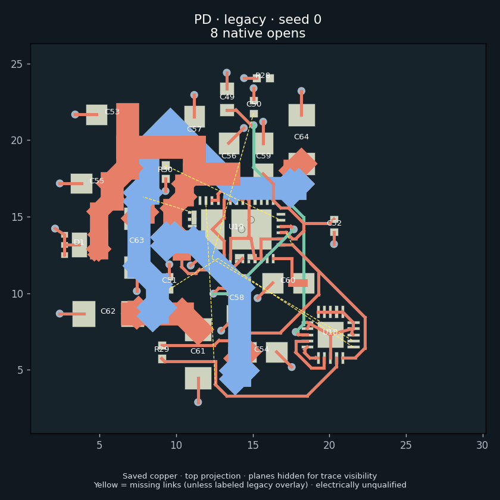
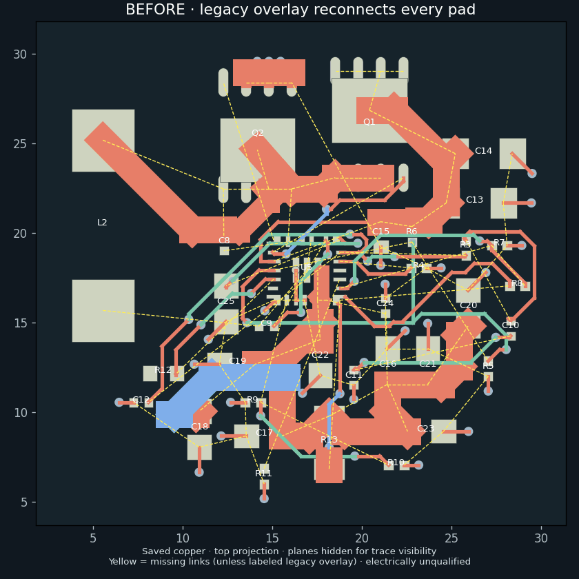

# Hierarchy, outline and power-loop regression gates

Current activation policy and combined regression results are tracked in
[PR #100 defaults](pr100-defaults.md). The measurements below retain their
original experiment configuration.

The Mini review exposed independently testable failures: a hierarchical block
could lose its external hard-group anchor during sub-board filtering; a native
outline with connector support ears became its rectangular bounding box; and
parallel devices sharing supply and return nets could disappear into one topology
class. The latter produced an empty, apparently clean power-loop report for a PD
capacitor bank. Native DRC connectivity alone cannot qualify that return path.

## Validators

`hier.partition` checks the original constraints before any sub-board is built.
Straddled anchors, member-relative keepouts, orientation relations and duplicate
membership fail with the original refs. This is independent of the repair.

The polygon is checked at ingest, final/incremental placement, channel refinement,
routing-grid construction and native writeback. Source and graph contours must
agree, allowing cyclic start and winding changes. Mismatched dimensions or contour,
multiple contours and internal cutouts fail explicitly in the native-outline mode.
Fixed interface overhangs retain the existing exemption.

`hier.power_coverage` establishes terminal obligations from carrying roles and
expands every parallel branch. An empty loop list or a selected best capacitor is
not evidence for the bank. Copper extraction preserves individual fill islands;
plated pads contact a zone only where their actual copper land intersects its fill.
This includes off-centre thermal contacts. Native DRC agreement remains mandatory.

`power_loop` screens each supply and return leg separately using the existing
resistive copper solver, actual layers, filled planes and plated vias. Each leg
receives the net's full RMS envelope: a conservative screening excitation, not a
prediction of capacitor ripple or current sharing. Connected IPC-2221 constrictions
fail the screen. Missing copper/current/fab models, solver failure, extraction
failure or timeout remain unqualified. Native hierarchy ranking records these
failures and completion cannot ignore them or other electrical objective terms.
AC impedance, inductance, component ripple limits and thermal qualification remain
open even after a clean screen. No inference here establishes full-board acceptance.
A model with no power nets is
explicitly not applicable; a power net with missing loop/model evidence is unqualified.
Reports retain the actual temperature-rise assumption used for the current screen.

## Initial candidate repairs (tested with explicit opt-in)

- `PNR_HIER_SAFE_PARTITION=1` closes whole candidate blocks over hard relations.
  Movable connected blocks merge; dependencies touching fixed/line/edge interfaces
  remain flat. This does not fix internal converter components in place.
- `PNR_NATIVE_OUTLINE=1` ingests and retains the actual single-contour board polygon.
  Constraint dimensions and coordinates must use that polygon's lower-left frame.
- `PNR_POWER_BRANCHES=1` keeps each carrying device as its own topology class and
  enables the copper screen. Pair with `PNR_POWER_FIRST=1` for placement optimization.
- `PNR_POWER_CHANNELS=1` retains shared power-net channel demand. Common net identity
  alone cannot establish an adequate pour. In the saved C53 scenario the legacy
  power-first heuristic erased a 1.21 congestion penalty without native copper evidence.

The repair flags are included in feedback/cache provenance, so legacy evidence
cannot qualify a different repair configuration. Native DRC and electrical limits
are not relaxed. Disable the candidate flags to roll back search behavior.

## Measured local comparison

Frozen source fixtures, seeds 0 and 1, 120 placement iterations per arm, one numeric
thread, identical constraints and rules. Both arms are scored with the all-branch
objective (lower is better); all eight placements are legal.

| Fixture   | Seed | Legacy classes | Individual branches | Reduction |
| --------- | ---: | -------------: | ------------------: | --------: |
| PD        |    0 |        1674.68 |             1040.34 |     37.9% |
| PD        |    1 |        1914.86 |              941.86 |     50.8% |
| Converter |    0 |        1435.88 |             1104.33 |     23.1% |
| Converter |    1 |        1740.53 |             1437.02 |     17.4% |

These are placement-proxy improvements, not routed electrical passes. On the
unchanged saved PD copper, legacy topology emitted zero links; branch mode measures
14 and covers all 18 obligated terminals. The native connectivity check agrees with
KiCad, including its remaining open. The independent current screen still fails
that board. With the updated article interface constraints applied to the archived compiled
source, safe partitioning retains 12 useful blocks (including converter and PD) and removes both source
relation violations; this is not accomplished by flattening the entire article.

## Native routing comparison

Mechanically selected minimum all-branch placement score from each two-seed arm,
then identical 60-second route-phase budgets and a 300-second evaluation deadline.
These are isolated four-layer module fixtures, not the new full six-layer article.
All six evaluations completed their final audit; all still fail electrical gates.
Each board has zero native DRC violations. Counts below remain failures.

| Module    | Placement arm   | Seed | Opens | Subwidth tracks | Open hot links | Current-screen failures |
| --------- | --------------- | ---: | ----: | --------------: | -------------: | ----------------------: |
| PD        | legacy          |    0 |     8 |              21 |              1 |                      17 |
| PD        | branches        |    1 |     7 |              30 |              0 |                      20 |
| PD        | strict channels |    1 |     6 |              29 |              0 |                      19 |
| CONVERTER | legacy          |    0 |    16 |              34 |              2 |                      15 |
| CONVERTER | branches        |    0 |     9 |              31 |              1 |                      15 |
| CONVERTER | strict channels |    0 |    10 |              44 |              0 |                      16 |

Branch-aware placement improves converter connectivity and width counts. For PD,
strict channel accounting improves on the branch-only candidate, but its width and
current counts remain worse than the original control. Strict accounting regresses
the converter, so it is not promoted globally. The current screen uses a conservative
per-branch full-envelope excitation; these counts are not capacitor ripple-current
predictions. AC/thermal models and complete routed electrical closure remain open.

The second candidate follows an observed native tradeoff rather than optimizing
only the proxy. Seeds, source/tool inputs, failures and exact boards are retained.
These clock-limited probes neither establish a plateau nor guarantee bitwise replay
on another runtime. The packed router fallback was used in every arm because this
isolated source bundle did not contain the optional native maze library.

## Regression execution

`bazel test --config=lowmem //hardware/pnr:mini_engine_scenarios_test` includes
source-relation scenarios, ear/notch placement and routing, stale dimensions,
parallel-bank coverage, open second returns, disconnected fill islands, connected
narrow-return/wide-control screening, completion/ranking and feedback provenance.
The saved C15/C53 placement fixtures preserve the original channel gaps (0.757 and
0.700 mm versus 1.800 mm estimated demand), generic pose ranking and bounded channel
refinement. These geometry estimates do not establish routing success.

The target also repeats the equal-budget placement comparison above. Native tests
skip explicitly without `pcbnew`; run the two native cases under the packaged
headless KiCad Python with the engine/test modules and PyYAML on `PYTHONPATH`:

```sh
python -m unittest \
  test_mini_engine_scenarios.OutlineScenarios.test_native_pad_ears_preserve_area_and_physical_origin \
  test_mini_engine_scenarios.PowerScenarios.test_native_off_centre_pad_contacts_keep_fill_islands_separate
```

The first checks physical origin, 3858 square mm area, exact native round-trip and
same-bounds/wrong-contour rejection. The second constructs native plated pads and
separate off-centre fill islands; no synthetic connectivity shortcuts are used.
Private run evidence retains frozen inputs, hashes, flags, seeds, solver reports and
failed iterations. Never publish machine paths or run logs in this repository.

## Visual examples

These animations alternate two **saved final boards**, with the same viewport per
module; they are comparisons, not invented intermediate solver steps. Seeds and
native board SHA-256 hashes are retained in the adjacent geometry JSON. The
renders hide planes to make tracks readable; the four-layer sheets include fills.
The displayed candidate is the lowest-open result in the recorded comparison,
not a claim that it wins every electrical metric.





[Converter four-layer sheet](assets/mini-engine-repair/converter.png) and
[PD four-layer sheet](assets/mini-engine-repair/pd.png) show the exact saved copper.
Yellow dashed lines on those sheets come from native DRC missing connections.

The viewer formerly drew an all-pad minimum spanning tree even on connected nets.
It now contracts native connected copper islands first and displays only missing
links, minimizing pad/via-centre and track-endpoint distances. These are geometric
anchor distances, not copper-edge clearance or routed path lengths. The native
extractor produces 9 and 6 links on the displayed converter and PD respectively,
matching their DRC open counts. Old caches refresh only against matching native
board hashes; unavailable connectivity disables the overlay rather than guessing.



Rebuild the animations using Python with matplotlib 3.10.1 and Pillow:

```sh
python docs/design/assets/mini-engine-repair/render.py
```

The renderer consumes only committed geometry, does not rerun or select solver
candidates, and labels the legacy overlay explicitly. The airwire animation changes
only the overlay on the identical saved converter board. Interactive display,
cache migration, minimum-link selection, coincident disconnected anchors and
connected-net suppression have focused regressions. Browser checks run in CI.
