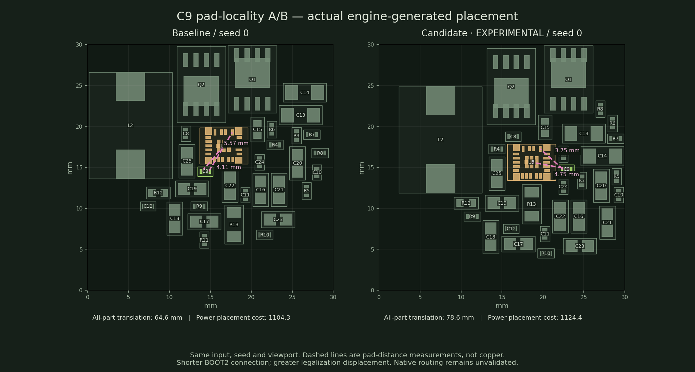
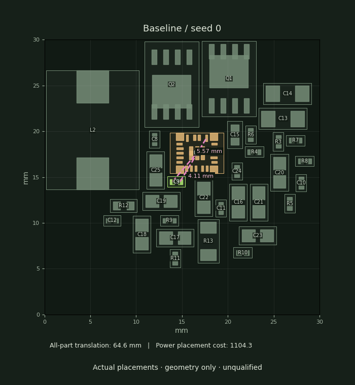

# Pad-locality and legalization laboratory

A bootstrap capacitor can satisfy a component-centre group radius while sitting far
from its IC terminals. The existing power branch validator also does not infer a
BOOT-to-SW bootstrap obligation from supply/return classifications. Neither a legal
placement nor a power-bank coverage pass establishes this capacitor's locality.

`PNR_PAD_LOCALITY=1` adds both-terminal attraction to corresponding physical IC pads,
including duplicate-pad alternatives. Ownership requires an explicit pad group or an
unambiguous private connection plus the second shared net. Shared power/ground and broad
hierarchy groups alone cannot assign a part to an arbitrary IC. The candidate also honors
`anchor_pad` in both global optimizers; previously those optimizers used the anchor's centre
while the legalizer used its pad. The local term participates in legal site and orientation
selection. It is **experimental, default-off, and not ready for default enablement**.

The independent audit reports every inferred terminal obligation. Explicit geometry limits
can fail a placement; absent limits remain unqualified. Distances are geometric, including
possible buried/thermal-pad alternatives, and do not establish routable escape, bootstrap
loop inductance or electrical qualification. No article limits or native DRC gates change.

## A/B findings

Both converter and PD source fixtures use seeds 0 and 1, 120 placement iterations, one thread,
and identical constraints. Power-first placement, individual power branches and safe hierarchy
partitioning are enabled; strict shared-power channels are off. All eight placements are legal.
The table reports every seed, without hand-picking the favorable one.

| Case      | Seed | Pad-distance sum, baseline → candidate (mm) | Legalization translation, baseline → candidate (mm) | Power cost, baseline → candidate |
| --------- | ---: | ------------------------------------------: | --------------------------------------------------: | -------------------------------: |
| Converter |    0 |                               60.00 → 38.94 |                                       64.56 → 78.59 |                1104.33 → 1124.36 |
| Converter |    1 |                               55.76 → 31.59 |                                     102.38 → 117.86 |                1437.02 → 1488.58 |
| PD        |    0 |                               35.54 → 16.88 |                                       20.58 → 41.82 |                1040.34 → 1089.73 |
| PD        |    1 |                               22.52 → 16.84 |                                       35.19 → 33.61 |                 941.86 → 1012.82 |

Pad distance improves, but movement regresses in three of four comparisons and the
unchanged power objective regresses in all four. This is useful diagnostic evidence,
**not a successful placement fix or routed-board improvement**. Further tuning must
reduce legalization translation and protect the power objective before promotion.
Native routing was not rerun for this unpromoted candidate.

For seed 0, C9's BOOT2 straight-line gap improves from 5.57 to 3.75 mm, while its nearest
SW2-pad gap worsens from 4.11 to 4.75 mm. Looking at only the first terminal would hide that
regression. The visual highlights both terminals and retains the same viewport.

The saved layouts, measured obligations and all-seed results are in
[placements.json](assets/mini-pad-locality/placements.json), with
[source and input hashes](assets/mini-pad-locality/provenance.json). All eight layouts
reproduced exactly from the frozen final engine. Regenerate the figures with
`python tools/render_pad_locality.py docs/design/assets/mini-pad-locality/placements.json OUTPUT_DIR`
using Matplotlib and Pillow. Frames are the actual engine outputs, with no fabricated
intermediate geometry or copper.

## Review and tuning

The [placement laboratory](../../yapnr/viewer/PLACEMENT-LAB.md) provides an editable linear
objective expression, live optimizer frames, pause/resume, deterministic seeds, frozen engine
sources, iteration-indexed expression history, and sequential legalizer decision review.
Each decision retains the original and selected poses, occupied predecessors, evaluated
alternatives and additive cost terms. Canonical notes carry the immutable decision hash.

The live editor runs the single-start global optimizer, separately from recorded power-first
A/B runs. A 1,000-iteration live test paused and changed spreading weight at iteration 841;
reapplying the saved weight schedule to the frozen engine reproduced the continuous placement
JSON exactly. Unit coverage also verifies observational callbacks do not change placement,
locality capture-on/off equivalence, actual-loss/replay parity, pad ownership/duplicates,
DSL rejection and hash-bound review. Final hard placement and electrical validation remain
independent of the editable objective.
