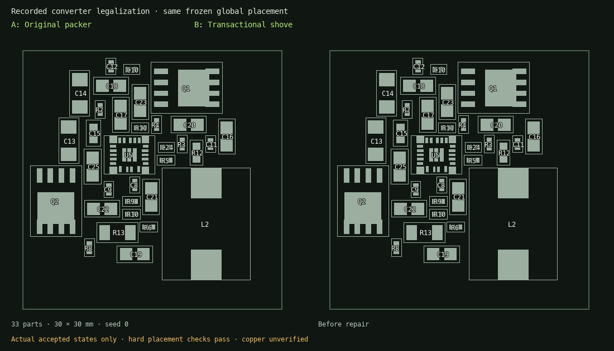

# Transactional placement shove and capacitor banks

The sequential legalizer can strand a late component even when small translations
of earlier neighbours would leave a much better placement. A local rotation can
also win its own slot comparison while taking space needed by another component.

`PNR_LEGALIZE_SHOVE=1` enables a repair pass after ordinary legalization. It compares
proposals against the original continuous-placement targets, with three bounded
passes, a deterministic beam of twelve states and at most eight contact levels.
Neighbour translations are limited to 4 mm per transaction. No random selection or
machine-speed-dependent stopping participates in this search.

Each proposal moves an incoming component toward its target and propagates
collisions to neighbouring components. The complete transaction must reduce the
whole-board sum of squared target displacement, rotation-change cost, pad-locality
cost, channel-shortage cost and authored soft spatial constraints. A quarter-turn
costs the square of the component's largest courtyard dimension. The incoming
component can recover its original rotation; neighbours retain their rotations and
sides. This objective is distinct from the global optimizer's live expression.

The pose checker and independent full hard-constraint checker must accept the
complete result. Fixed and locked components, rigid macros, rows, alignment groups
and landing-reserve components remain held. Hard group relations are rechecked for
both moved anchors and their members. A failed proposal restores all poses. The
search is bounded and does not establish optimality or routing success.



The animation contains only accepted engine states. Its
[manifest](assets/mini-pad-locality/placement-shove.json) binds the inputs, decisions
and images by SHA-256.

## Authored bank subgroups

`PNR_PLACEMENT_BANKS=1` activates explicitly authored bulk-capacitor placement
subgroups inside an existing converter block:

```yaml
placement_bank:
  - name: converter.output_bank
    parent: board.converter
    members: [C1, C2, C3, C4]
    max_span_mm: 7
    weight: 20
```

All members must share the same two electrical nets. Membership is explicit: sharing
a power rail alone never assigns unrelated decouplers to a bank. Input and output
banks are separate; pin-local high-frequency capacitors should stay outside them.
Names are unique and memberships disjoint. `parent` records source hierarchy intent.

Global placement adds pairwise compactness penalties without privileging one
capacitor as an anchor. When enabled, `max_span_mm` also becomes a hard maximum
pairwise origin distance during legalization and independent checks. This prevents
the packer from undoing the compactness objective. An infeasible bank is a reported
placement failure; its bound is never silently enlarged. Without the flag, bank
metadata has no placement effect.

A bank member may repair its internal packing. A component outside the bank must
shove the bank collectively, preserving its current internal layout. These are
nested **placement** groups, not recursively synthesized, pre-routed copper macros.
Bank shape, pad access, power/return copper, loop current and electrical performance
still require routing and electrical validation.

## Laboratory and evidence

The lab exposes **Experimental shove repair**, **Authored capacitor banks**, and
**Legalize source poses only** on new runs. The latter consumes the registered
source's exact poses, performs zero optimizer updates, and supports isolated
legalization A/B replay. It cannot run paused or indefinitely.

Shove decisions follow the original packer decisions in the review sequence. Each
has an immutable before graph, all changed poses, original global target and
aggregate before/after cost decomposition. Amber outlines and green placements
show every affected component, and airwires use every accepted pose. Notes attach
to the transaction's content hash, as they do for individual packing decisions.
The Python/HTTP/CLI APIs expose `shove`, `placement_banks` and `legalize_only` on
`start`; CLI equivalents are `--shove`, `--placement-banks`, `--legalize-only`.

## Initial measured replay

A 33-part converter was re-legalized from the same frozen continuous placement,
0.25 mm grid, original constraints, pad-locality and channel model:

| Measure                             | Original packer |     Shove |
| ----------------------------------- | --------------: | --------: |
| Total translation from global poses |       46.911 mm | 37.199 mm |
| Maximum translation                 |        9.633 mm |  3.578 mm |
| Rotation changes                    |               2 |         0 |
| C9 displacement                     |        2.011 mm |  0.961 mm |
| C10 displacement                    |        7.260 mm |  1.835 mm |
| C12 displacement                    |        9.633 mm |  1.443 mm |
| R8 displacement                     |        7.173 mm |  1.267 mm |
| R7 displacement                     |        2.025 mm |  2.025 mm |

The candidate accepted 31 transactions. All hard placement checks passed; R7 did
not improve. The new search took about 34.5 seconds versus 0.4 seconds for packing
alone on this run. This is placement evidence, not native copper DRC or electrical
qualification. The experimental flags remain off by default.

A separate seed-0, 400-iteration global A/B used the same fixed objective and
source poses. Enabling the authored output bank reduced its final pairwise span
from 20.08 mm to the declared 9.00 mm; the input bank ended at 2.92 mm within its
6 mm bound. This needed a stronger bank penalty (weight 20). Weight 4 left the
continuous bank too scattered and bounded legalization failed, rather than
silently relaxing the 9 mm constraint. All hard placement checks passed on the
weight-20 candidate. It still had an 8.17 mm worst legalization move and three
rotation changes elsewhere; compact banks are not yet a demonstrated overall
routing improvement. The same frozen annotated placement above isolates shove
without changing bank intent or global optimization.

## Why changing the overlap centroid is insufficient

The current global overlap term sums pairwise overlap area. Opposing derivatives
can cancel for an interior component. In symmetric chains of 3, 7 and 15 unit
parts spaced 0.6 units apart, the middle component has zero overlap gradient in
all three cases; the outer component's gradient magnitude stays one. Multiplying
the overlap weight or changing the cluster's reference point cannot remove that
symmetry. It is also correct for the middle component to stay centred if its
neighbours can move outward.

The existing contact-separation solver clears those three synthetic chains by
propagating spacing constraints, to within 1e-6 per contact. This supports testing a
contact projection or contact-pressure method in global optimization. It does not
establish that such a method improves general boards. This patch leaves the live
`spread_overlap` objective and its gradients unchanged.

## Native routing follow-up

The same frozen baseline and shove placements were routed with one worker,
60-second signal budgets, identical native phases and headless KiCad. Both used
the packed maze fallback available in this runtime. There were zero native DRC
geometric violations in either final artifact, but neither completed routing:

| Final artifact | Unconnected | Subwidth tracks |
| -------------- | ----------: | --------------: |
| Baseline       |          17 |              47 |
| Shove          |          19 |              32 |

Shove reduces width findings but regresses connectivity in this bounded probe.
It is not evidence for enabling a default or claiming convergence. The
[SMPS screens](smps-validation.md) find further defects in both boards.
[All measurements and hashes](assets/mini-pad-locality/layout-choice-study.json)
include the separate six-case converter power-placement study; power-first helps
both seeds, while compact bank grouping has mixed effects. Those power placements
have not yet been natively routed.
