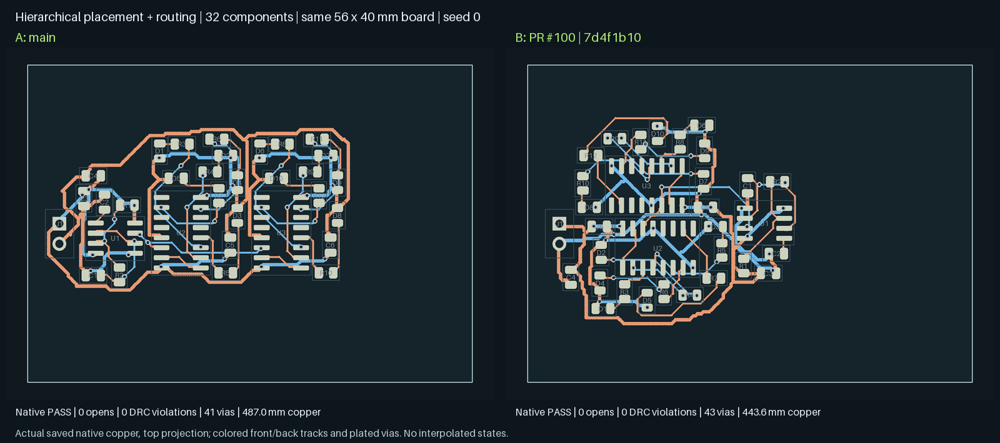

# PR #100 default activation and validation

All production features introduced by PR #100 are enabled by default. Each Boolean
engine switch accepts an explicit `0` to restore its ablation. Electrical limits,
KiCad DRC, total differential-pair contracts and evidence requirements are unchanged.

| Switch                         | Behavior                                                                                 |
| ------------------------------ | ---------------------------------------------------------------------------------------- |
| `PNR_HIER_SAFE_PARTITION`      | Preserve hard relationships across block partitioning                                    |
| `PNR_NATIVE_OUTLINE`           | Preserve the actual board contour and reject inconsistent dimensions                     |
| `PNR_POWER_BRANCHES`           | Cover every carrying branch and require native power screening                           |
| `PNR_POWER_CHANNELS`           | Retain channel demand for shared power nets                                              |
| `PNR_PAD_LOCALITY`             | Attract small components to the actual connected IC pads                                 |
| `PNR_LEGALIZE_SHOVE`           | Transactional neighbor displacement with complete legality checks                        |
| `PNR_PLACEMENT_BANKS`          | Honor authored capacitor banks and their maximum span                                    |
| `PNR_SMPS_LAYOUT`              | Run declared SMPS checks and retain unknown qualification                                |
| `PNR_SMPS_PLACEMENT`           | Include declared SMPS geometric debt in placement                                        |
| `PNR_INGEST_COPPER_PADS`       | Exclude mask/paste-only apertures from copper-pad occupancy                              |
| `PNR_PLANE_ACCESS_COMPACT_BUS` | Keep the full-width collector within its via-bank span                                   |
| `PNR_PLANE_ACCESS_NATIVE_FIT`  | Judge current-sized access with native geometry instead of symmetric courtyard inflation |
| `PNR_HIER_LAYOUT_DIVERSE`      | Preserve distinct valid block layouts in the search portfolio                            |

`PNR_HIER_LAYOUT_SEARCH` defaults to `alternating`: bounded variant swaps and parent
relaxation. `off`, `independent`, `frozen`, and `paired` remain selectable comparison
strategies. Mutually exclusive strategies are not run simultaneously. The existing
fixed evaluation and iteration limits remain active.

New placement-lab runs enable shove and authored banks in the browser, API and CLI.
`--no-shove` and `--no-placement-banks` opt out. Replay of older captures preserves
their recorded feature settings. Unlimited interactive running, legalize-only
replay and diagnostic captures remain explicit user actions; they are execution
modes, not disabled production repairs.

## Native ladder comparison

The full eight-case ladder at seeds 0 and 1 passes **16/16 on main and 16/16 with
these defaults**. Both arms have zero native unconnected items and DRC findings;
source-width, contact and placement checks pass. Identical four-round and
600-second stage budgets were used. Main is `9e19d73e`; candidate is `7d4f1b10`, with
the documented defaults, transaction-cache and hierarchy-spacing fixes. Seeds and frozen source hashes
are retained in the experiment evidence.

| Aggregate measure      |       Main | New defaults | Change |
| ---------------------- | ---------: | -----------: | -----: |
| Copper length          | 1705.71 mm |   1551.12 mm |  −9.1% |
| Vias                   |        130 |          108 | −16.9% |
| Place/route phase time |   149.44 s |     266.05 s | +78.0% |
| All stage time         |   491.56 s |     580.32 s | +18.1% |
| CPU time               |   934.45 s |    1014.45 s |  +8.6% |
| Campaign elapsed       |      562 s |        645 s | +14.7% |

The default repairs trade runtime for less copper and fewer vias in this ladder;
there is no claim of a universal speedup. Shove's repeated geometry/channel
calculations are cached without changing proposal order or acceptance. A separate
representative 20-part placement fell from 19.64 to 3.84 seconds, with identical
final geometry and transaction decisions; turning shove off took 1.76 seconds.

## Native showcases

All five showcases pass on main and `7d4f1b10`, including the hierarchical
twin-bank design. Aggregate copper falls from 1233.55 to 1143.86 mm (7.3%) and
vias from 79 to 75. Total measured stage time rises from 246.35 to 333.47 seconds;
place/route time rises from 96.43 to 187.64 seconds. CPU time is 424.86 versus
496.58 seconds. Timings were measured on a shared development machine.

This same-outline, seed-0 comparison shows the final saved copper. Both boards
have zero native opens and DRC findings. Opposing bank orientations reduce copper
from 487.01 to 443.60 mm, with 41 versus 43 vias. Layer-by-layer visual review
found no apparent copper or placement defect. Nearby vias were checked against
actual contacts; proximity alone was not used to declare redundancy.
[Board and copper hashes](assets/pr100-defaults/hierarchy-native-ab.json)
identify the rendered artifacts.

## Scheduled hard regressions

All 20 scheduled hard cases pass on both arms at seed 0: the six public hard cases
and fourteen nightly variants, including four-, six- and eight-layer chasers,
double-sided and fixed-placement cases, arc-preserving copper, MCU USB,
quad banks, power switches, buck pours and both UFBGA201 fanout variants.
There are zero native opens, DRC findings or failed runner qualification gates.

| Aggregate measure      |       Main | New defaults | Change |
| ---------------------- | ---------: | -----------: | -----: |
| Copper length          | 6362.76 mm |   6050.52 mm |  −4.9% |
| Vias                   |        779 |          749 |  −3.9% |
| Place/route phase time |   710.26 s |     868.77 s | +22.3% |
| All stage time         |  1455.19 s |    1599.71 s |  +9.9% |
| CPU time               |  2301.03 s |    2405.02 s |  +4.5% |

Both hard arms shared the host with another bounded routing worker; timing is a
measured shared-host cost, not a controlled hardware benchmark. Improvements are
aggregate: the fixed absolute-position case grows from 273.94 to 314.70 mm and
16 to 22 vias; the quad-bank case grows from 816.52 to 888.89 mm while reducing
vias from 76 to 71. All remain qualified by the same runner gates.

## Validation scope

The scheduled native comparison totals **41/41 passes per arm**: sixteen ladder
runs, five showcases and twenty hard runs. Frozen runtime sources match
`7d4f1b10`; `26170f97` changes only Bazel test size metadata. The sixteen other
manual hard variants and the separate RF nightly campaign are not included.
`12-soc-bga-113` belongs to the manual stress inventory and is evaluated separately
with a disclosed reduced budget; it is not included in the 41 passing runs.

All **310 Bazel test targets** and all-file hooks pass on `26170f97`, along with
27 browser tests and native current-sized collector regressions at four rotations.
Full-placement region/alignment and hard-edge integration tests needed appropriate
Bazel timeout classes on shared CI runners (900 and 300 seconds respectively).
Their iterations, seeds and assertions are unchanged, as are production budgets.

The hierarchy correction uses the legalizer's authored courtyard gap instead of
incorrectly adding copper clearance; positive and negative spacing regressions
retain the original native copper rules. Failed search seeds retain diagnostics
and allow the caller to try its remaining declared seeds. Native edge tests cover
preserved contours by default and rectangular stamping with the explicit opt-out.

Final native boards were exported through headless KiCad for paired clean and
annotated layer review. Nearby vias were checked against actual pad/track contacts
and reviewed planes, including blind/buried transitions; close spacing alone does
not prove redundant copper. Some fabrication labels remain crowded or extend
outside the outline in synthetic fixtures. Long signal detours remain possible.
These observations do not replace native DRC or electrical qualification.

The clean code suite and scheduled routing passes do not establish that every
board is routed or electrically qualified. The SMPS article remains unqualified
as recorded in [the closure investigation](smps-closure.md). Final platform CI and
the separate manual stress outcome are recorded on PR #100.
