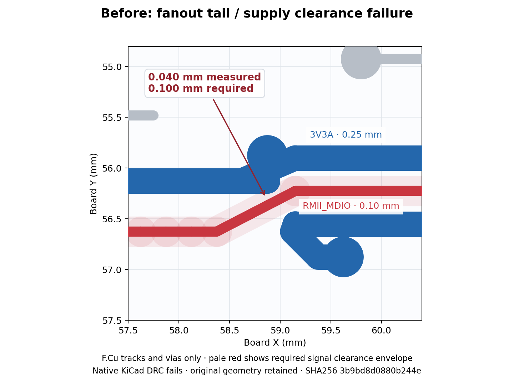

# PR #100 default activation and validation

All production features introduced by PR #100 are enabled by default. Each Boolean
engine switch accepts an explicit `0` to restore its ablation. Electrical limits,
KiCad DRC, total differential-pair contracts and evidence requirements are unchanged.

| Switch                         | Behavior                                                                                 |
| ------------------------------ | ---------------------------------------------------------------------------------------- |
| `PNR_HIER_SAFE_PARTITION`      | Preserve hard relationships across block partitioning                                    |
| `PNR_NATIVE_OUTLINE`           | Preserve the actual board contour and reject inconsistent dimensions                     |
| `PNR_POWER_BRANCHES`           | Cover every carrying branch and require native power screening                           |
| `PNR_POWER_CHANNELS`           | Retain channel demand for shared power nets                                              |
| `PNR_PAD_LOCALITY`             | Attract small components to the actual connected IC pads                                 |
| `PNR_LEGALIZE_SHOVE`           | Transactional neighbor displacement with complete legality checks                        |
| `PNR_PLACEMENT_BANKS`          | Honor authored capacitor banks and their maximum span                                    |
| `PNR_SMPS_LAYOUT`              | Run declared SMPS checks and retain unknown qualification                                |
| `PNR_SMPS_PLACEMENT`           | Include declared SMPS geometric debt in placement                                        |
| `PNR_INGEST_COPPER_PADS`       | Exclude mask/paste-only apertures from copper-pad occupancy                              |
| `PNR_PLANE_ACCESS_COMPACT_BUS` | Keep the full-width collector within its via-bank span                                   |
| `PNR_PLANE_ACCESS_NATIVE_FIT`  | Judge current-sized access with native geometry instead of symmetric courtyard inflation |
| `PNR_HIER_LAYOUT_DIVERSE`      | Preserve distinct valid block layouts in the search portfolio                            |

`PNR_HIER_LAYOUT_SEARCH` defaults to `alternating`: bounded variant swaps and parent
relaxation. `off`, `independent`, `frozen`, and `paired` remain selectable comparison
strategies. Mutually exclusive strategies are not run simultaneously. The existing
fixed evaluation and iteration limits remain active.

New placement-lab runs enable shove and authored banks in the browser, API and CLI.
`--no-shove` and `--no-placement-banks` opt out. Replay of older captures preserves
their recorded feature settings. Unlimited interactive running, legalize-only
replay and diagnostic captures remain explicit user actions; they are execution
modes, not disabled production repairs.

## Native ladder comparison

The full eight-case ladder at seeds 0 and 1 passes **16/16 on main and 16/16 with
these defaults**. Both arms have zero native unconnected items and DRC findings;
source-width, contact and placement checks pass. Identical four-round and
600-second stage budgets were used. Main is `9e19d73e`; candidate is `c50ffdfc`, with
the documented defaults, scalar transaction cache, hierarchy-spacing and fanout
clearance fixes. Seeds and frozen source hashes are retained in the experiment
evidence.

| Aggregate measure      |       Main | New defaults | Change |
| ---------------------- | ---------: | -----------: | -----: |
| Copper length          | 1705.71 mm |   1551.12 mm |  −9.1% |
| Vias                   |        130 |          108 | −16.9% |
| Place/route phase time |   149.44 s |     189.75 s | +27.0% |
| All stage time         |   491.56 s |     497.23 s |  +1.2% |
| CPU time               |   934.45 s |     916.11 s |  −2.0% |
| Campaign elapsed       |   561.85 s |     559.69 s |  −0.4% |

The default repairs use more place/route phase time for less copper and fewer
vias in this ladder; all-stage time is similar. There is no claim of a universal
speedup. Shove's repeated geometry/channel
calculations are cached without changing proposal order or acceptance. A separate
representative 20-part placement fell from 19.64 to 3.84 seconds, with identical
final geometry and transaction decisions; turning shove off took 1.76 seconds.

## Native showcases

All five showcases pass on main and `c50ffdfc`, including the hierarchical
twin-bank design. Aggregate copper falls from 1233.55 to 1143.86 mm (7.3%) and
vias from 79 to 75. Total measured stage time rises from 246.35 to 249.94 seconds (1.5%);
place/route time rises from 96.43 to 123.26 seconds (27.8%). CPU time is 424.86
versus 419.64 seconds; campaign elapsed is 268.62 versus 270.31 seconds. Timings
were measured on a shared development machine.

This same-outline, seed-0 comparison shows the final saved copper. Both boards
have zero native opens and DRC findings. Opposing bank orientations reduce copper
from 487.01 to 443.60 mm, with 41 versus 43 vias. Layer-by-layer visual review
found no apparent copper or placement defect. Nearby vias were checked against
actual contacts; proximity alone was not used to declare redundancy.
[Board and copper hashes](assets/pr100-defaults/hierarchy-native-ab.json)
identify the rendered artifacts.

## Scheduled hard regressions

All 20 scheduled hard cases pass on both arms at seed 0: the six public hard cases
and fourteen nightly variants, including four-, six- and eight-layer chasers,
double-sided and fixed-placement cases, arc-preserving copper, MCU USB,
quad banks, power switches, buck pours and both UFBGA201 fanout variants.
There are zero native opens, DRC findings or failed runner qualification gates.

| Aggregate measure      |       Main | New defaults | Change |
| ---------------------- | ---------: | -----------: | -----: |
| Copper length          | 6362.76 mm |   6060.93 mm |  −4.7% |
| Vias                   |        779 |          742 |  −4.7% |
| Place/route phase time |   710.26 s |     637.65 s | −10.2% |
| All stage time         |  1455.19 s |    1277.40 s | −12.2% |
| CPU time               |  2301.03 s |    2070.58 s | −10.0% |

The arms ran on a shared host, with bounded routing and rendering work during
parts of the campaign; timing is a measured shared-host cost, not a controlled
hardware benchmark. Hard campaign elapsed is 1457.00 versus 1278.94 seconds.
Improvements are
aggregate: the fixed absolute-position case grows from 273.94 to 314.70 mm and
16 to 22 vias; the quad-bank case grows from 816.52 to 888.89 mm while reducing
vias from 76 to 71. All remain qualified by the same runner gates.

## Manual SoC stress investigation

`12-soc-bga-113`, seed 0, was evaluated separately with four routing rounds,
a 1,500-second stage limit and a 1,800-second campaign limit. Its normal manual
budget is 240 minutes; this is a reduced-effort comparison, not full manual-suite
coverage. No attempt below qualifies the board.

| Runtime                      | Campaign elapsed | Native opens | Native skew findings | Native clearance findings |
| ---------------------------- | ---------------: | -----------: | -------------------: | ------------------------: |
| Main `9e19d73e`              |          762.1 s |           39 |                   10 |                         0 |
| Initial defaults `7d4f1b10`  |         1502.8 s |  unavailable |          unavailable |               unavailable |
| Scalar cache `57fb816f`      |         1004.3 s |           38 |                   10 |                         2 |
| Escape protection `47924da5` |         1065.5 s |           41 |                    8 |                         0 |

The initial defaults exhausted the stage limit after one round without a final
native board; unavailable results are not zero or passes. The scalar channel
cache preserves directional summation order and skips only pairs whose original
contributions are zero. All eight initial placements retain identical poses and
scores while their combined time falls from 1342.447 to 385.657 seconds. Main's
initial pool took 113.548 seconds. The enabled repairs still have a placement
cost, but the complete four-round search now fits the unchanged effort limit.

The new placement exposed an escape-halo defect: pad halos reserve touched cells,
but fanout tails reserve cell centers. Reusing the pad-style `track + pitch`
threshold let a 0.25 mm supply track approach a 0.10 mm tail to 0.04 mm against a
0.10 mm rule. Width-specific tables now protect intermediate-width tracks too.
A coarse-grid guard keeps their halo radii nonnegative. Regression tests cover
both outer layers, every surviving cardinal/diagonal edge and three grid pitches.
[Native artifact and crop metadata](assets/pr100-defaults/soc-fanout-clearance-before.json)
identify the unchanged geometry shown above; pads and planes are omitted from
this track/via diagnostic crop.

The corrected engine refuses the unsafe RMII_MDIO crossing, leaving that net
unrouted with two native open items. It has not found a clean alternate route.
The net and acceptance gates remain present. All three differential-pair
qualification failures also persist. Fewer skew findings and no new clearance
violations come with more opens: this is mixed evidence, not routing completion.

The last actual SoC run used `47924da5`. Its mapping to `c50ffdfc` is explicit:
the only subsequent runtime change clamps a negative halo extent to zero. The
SoC's 0.25 mm grid, minimum 0.10 mm track width and minimum 0.10 mm clearance give
a strictly positive minimum extent of 0.025 mm, so this guard is inactive.
Exact source/AST differences, inputs, seeds and native output hashes are retained.

## Validation scope

The scheduled native comparison totals **41/41 passes per arm**: sixteen ladder
runs, five showcases and twenty hard runs. Frozen candidate runtime sources match
`c50ffdfc`. Across those runs, copper falls 5.9%, vias 6.4%, all-stage time 7.7%
and CPU time 6.9%; place/route phase time falls 0.6%. The sixteen other manual
hard variants are not included.
`12-soc-bga-113` belongs to the manual stress inventory and is evaluated separately
with a disclosed reduced budget; it is not included in the 41 passing runs.
[Per-case results, seeds and native board hashes](assets/pr100-defaults/native-regression-summary.json)
retain the complete scheduled comparison.

All **310 regular Bazel test targets** pass locally and in both Linux and macOS
CI on `c50ffdfc`, along with all-file hooks, container/wheel builds on both
architectures, native CI ladder checks, 27 browser tests and native current-sized
collector regressions at four rotations. The separate RF nightly configuration
passes 24 targets per platform using content-cached results; no new RF solver
execution is claimed.
The supplemental native inventory selects 119 methods across 22 modules: **118
pass and one is skipped** because the local KiCad interpreter lacks PyTorch for
the bottom-side footprint-point check. A duplicate full-PnR gloss test is excluded;
the scheduled ladder separately exercises that pipeline. Negative native open/short
controls pass. The four energy-controller tests use private Shapely 2.0.7 because
local KiCad embeds Python 3.9; packaged Shapely 2.1.2 requires newer Python. No
package pin was changed or exact 2.1.2 native-energy result claimed. The documented
pre-existing manual detail-route, retry-controller and progress/placement-budget
fixture tests are outside the regular 310-target lane and are not claimed as
passes.

Expanded native testing also fixes two test-harness defects: the energy fixture
no longer passes the controller Python's standard-library paths to KiCad's
different Python version, and the library-table test honors the explicit
headless CLI override with bounded subprocesses. Production runtime is unchanged
by those test fixes.

Full-placement region/alignment and hard-edge integration tests needed appropriate
Bazel timeout classes on shared CI runners (900 and 300 seconds respectively).
Their iterations, seeds and assertions are unchanged, as are production budgets.

The hierarchy correction uses the legalizer's authored courtyard gap instead of
incorrectly adding copper clearance; positive and negative spacing regressions
retain the original native copper rules. Failed search seeds retain diagnostics
and allow the caller to try its remaining declared seeds. Native edge tests cover
preserved contours by default and rectangular stamping with the explicit opt-out.

Final native boards have paired clean and annotated layer review. Forty of the
41 final candidate boards match the previously reviewed geometry exactly after
removing only UUIDs and normalizing top-level serialization order. Exact byte
hashes remain recorded alongside semantic comparisons. The changed MCU USB board
and representative two-, four- and six-layer and hierarchical boards were freshly
exported and reviewed on the final runtime. Nearby vias were checked against actual pad/track contacts
and reviewed planes, including blind/buried transitions; close spacing alone does
not prove redundant copper. Some fabrication labels remain crowded or extend
outside the outline in synthetic fixtures. Long signal detours remain possible.
These observations do not replace native DRC or electrical qualification.

The clean code suite and scheduled routing passes do not establish that every
board is routed or electrically qualified. The SMPS article remains unqualified
as recorded in [the closure investigation](smps-closure.md). Final platform CI and
the separate manual stress outcome are recorded on PR #100.
