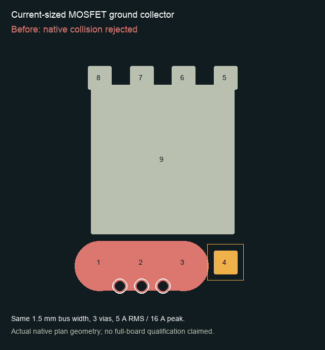

# SMPS placement and current-sized collector investigation

The Mini converter is **not fully routed or qualified**. This change addresses
independently observed obstacles without changing acceptance thresholds.

## Opt-in engine changes

- `PNR_SMPS_PLACEMENT=1`: use authored pad-distance, loop-perimeter and route-length
  limits in the global placer, power-first stages, slot scoring and cost inspector.
  Straight-line distance is only a necessary surrogate for routed length. Explicit
  perimeter limits take precedence over an area-derived conservative perimeter
  surrogate; the independent validator still measures actual loop area.
- `PNR_INGEST_COPPER_PADS=1`: ignore paste/mask-only apertures in routing terminals,
  nets and occupancy. Preserve actual copper and drilled mechanical holes.
- `PNR_PLANE_ACCESS_COMPACT_BUS=1`: collect source-pad feeds at the current-sized
  via bank instead of extending a wide bus to every outer pad centre. This avoids
  a same-footprint gate collision without narrowing the bus, removing vias or
  bypassing native copper, hole, edge and keepout checks.

- `PNR_PLANE_ACCESS_NATIVE_FIT=1`: defer the conservative symmetric courtyard
  expansion to actual native array construction. Placement still validates array
  sizing/span; native copper, via and hole guards remain mandatory. This allows
  same-net pads beside a collector instead of reserving empty space on every side
  of its footprint. Placement alone cannot qualify this mode.

All four switches default off. These are experimental improvements, not a new
qualified design or a change to manufacturing/electrical requirements.

## Native collector counterexample

The old collector collided with the adjacent MOSFET gate pad after correcting its
land pattern against the [TI CSD18531Q5A drawing](https://www.ti.com/lit/ds/symlink/csd18531q5a.pdf).
Both plans below come from the native generator on the same footprint. The before
plan was rejected before board mutation. The after plan passes the generator's
native collision checks and retains its 1.5 mm bus, three vias and 5 A RMS / 16 A
peak envelope. This is a local geometry result, not full-board acceptance.

[Side-by-side view](assets/smps-closure/collector.png) ·
[Exact plan geometry](assets/smps-closure/collector.json)

The regression repeats the counterexample at all four cardinal rotations and
checks current sizing and idempotent regeneration. Foreign copper rejection and
transactional behavior remain independently tested.

## Placement evidence

Four fixed seeds, 600 iterations each, same 33-part converter and legalizer:

| Geometry failures / nine checks        | Seed 0 | Seed 1 | Seed 2 | Seed 3 |
| -------------------------------------- | -----: | -----: | -----: | -----: |
| Original input, control                |      5 |      8 |      4 |      7 |
| Original input, SMPS objective         |      5 |      6 |      4 |      4 |
| Corrected MOSFET input, control        |      5 |      8 |      5 |      6 |
| Corrected MOSFET input, SMPS objective |      5 |      4 |      4 |      4 |

All these placements are legal; none passes all nine geometric checks. The new
objective helps some starts but does not establish automatic routing closure.

A separate prototype assembled solver-generated input switching cells and an
edge-aware controller-capacitor catalog, then used the ordinary parent placer.
Six of eight seeds passed placement legality and all nine geometric checks; two
failed the independent outline check. This prototype uses private numerical
experiment dependencies and is **not a packaged production placement API**.
Its outputs still require native routing and the complete final-board audit.

## Coupled feasibility and reservation ablation

With the experimental hard hierarchy and symmetric current-array reservations,
an exhaustive cardinal separation search found a necessary straight-line
inductor-span lower bound of 10.775 mm while respecting both 8 mm gate budgets.
This is a numerical convex result for those placement constraints, not a claim
that the electrical circuit is intrinsically infeasible.

Removing the extra hierarchy restrictions and symmetric reservation changes the
result: physical courtyard separation alone permits 6.592 mm for the maximum of
the two inductor spans, with the same gate and loop budgets. A subsequent
constrained polish produces 24 cores satisfying the unchanged loop-area,
perimeter, bypass and straight-line route bounds with rounding margins. The
internal group radii become soft search preferences; current, clearance and SMPS
acceptance limits do not change. Controller-capacitor catalogs and parent packing
still have to fit; actual current-array construction remains a native gate.
Six complete placements pass all nine geometric checks and legality. The first
two distinct cores also pass native array construction. Their completed native
runs retain nine and twelve unconnected items, respectively, with zero native
geometric DRC violations. They fail nine/eight SMPS checks and leave eight/nine
checks unqualified. The first has zero unjustified subwidth tracks; the second
has one. Neither qualifies.

## Native routing counterexamples

Routing the gate signals before power trunks is insufficient in the six generated
placements: every layout routes one zero-via gate path within 8 mm, but the other
requires 9.958 or 10.831 mm in the tested native surface search. Straight-line
placement limits miss these pad-obstacle detours. This is a failure of the tested
catalog/search, not a proof that no valid placement exists.

A separate controller-only counterexample retains every controller pad and the
original 5 A RMS / 16 A peak terminal contracts. The native power planner still
returns `no_current_sized_channel` for the SW2 peripheral/exposed-pad connection,
with zero qualified source-access ports. No surrounding components or routed
aggressors are present. This isolates pin-access geometry and current assignment
as unresolved factors; it does not prove physical impossibility or authorize a
smaller current budget. The reference design routes and actual branch loads need
to inform the next terminal-access experiment.

## Remaining gates

Do not equate geometric placement passes, zero subwidth exceptions, or process
completion with qualification. Native unconnected items, routed gate and switch
paths, current/return topology, plane coverage and sense routing remain separate
obligations. The existing exact-board evidence gates for ripple, load drop,
stability, shared-return error and temperature still require real evidence.

The frozen article also explicitly assigns the full switch-node current envelope
to bootstrap capacitor return branches. Those source contracts remain unchanged;
replacing them with gate-drive-specific envelopes requires engineering evidence
and designer approval. A bootstrap supply is a gate-drive branch according to the
[TPS552882 datasheet](https://www.ti.com/lit/ds/symlink/tps552882.pdf), but that fact
alone does not establish a qualified RMS or peak current budget.

Validation: all 310 Bazel targets pass. Native headless KiCad additionally passes
all four power-array cases, including the rotated gate-collision regression.
