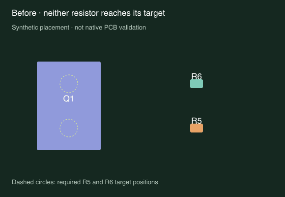
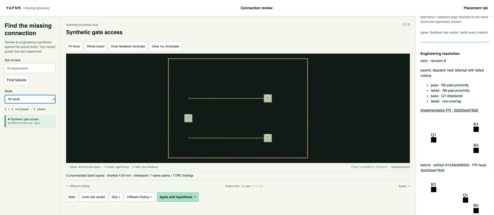

# Resolving engineering feedback

`yapnr feedback` turns an observation into a checked implementation. Recording a
review never starts a paid agent, and neither human agreement nor an agent's
“tested” response marks it addressed. The only closing transition executes the
parent's pinned validators against a clean checkout of the current PR head.

The connection-review viewer imports old and new actionable decisions idempotently.
It preserves the original note, rectangles, hypothesis revision and board hash.
Other feedback can be added from the CLI or data API. One item can have many failed
attempts; its original history is never replaced by the latest optimistic status.

## Parent and worker procedure

1. Record the self-contained feedback. Ask a real clarifying question only if
   necessary; `clarify` stops progress until `answer` records an actual response.
2. Write criteria, validators, a worked failing baseline and its visual. Include
   regression and native validation guards at the required engineering rigor.
   Each check must enumerate **all** its criterion IDs, even on failure.
3. Lock the plan. The command copies and hashes its files and actually executes
   the baseline. At least one desired-change criterion must fail; preserved
   constraints may pass. A baseline that does not demonstrate its declared
   outcomes is rejected.
4. Dispatch the complete copied task to a separate worker in its own checkout.
   The worker implements the change and opens a PR with committed visual evidence.
5. Submit that PR's exact head and artifact paths. The parent runs `verify`.
   GitHub metadata and the remote PR ref must independently agree on the head.
   The verifier checks out that commit into a separate temporary repository,
   executes the locked validators from outside it and requires all criteria.
6. On failure, dispatch again. The next task contains the concrete previous
   verification failures. `run` implements this bounded loop with a separately
   launched worker command. Only an independent all-pass result becomes addressed.

Queries revoke closure when pinned source files change or the PR head changes or
cannot be confirmed. A new feedback revision or new plan also revokes old evidence.
A stale item needs a new parent plan; prior attempts remain in the journal.

## CLI and receipt schemas

```sh
yapnr feedback add --project . --id gate-access --text 'Move both resistors toward their target pads, displacing the MOSFET without overlap.'
yapnr feedback query --project . --id gate-access
yapnr feedback plan --project . --id gate-access --expect-revision 1 --receipt evaluation/plan.json
```

The parent plan is a JSON object with this shape. Paths in `files` are relative to
the workspace. `repository` is the trusted Git repository URL. The same schema
supports several independent checks, including native DRC and regression suites.

```json
{
  "repository": "https://github.com/example/engine.git",
  "files": ["evaluation/validator.py", "evaluation/before.json", "evaluation/before.svg"],
  "before_visual": "evaluation/before.svg",
  "settings": { "seed": 0, "fixture_kind": "synthetic placement" },
  "criteria": [
    { "id": "R5-pad-proximity", "check": "placement", "baseline": "fail" },
    { "id": "R6-pad-proximity", "check": "placement", "baseline": "fail" },
    { "id": "Q1-displaced", "check": "placement", "baseline": "fail" },
    { "id": "non-overlap", "check": "placement", "baseline": "pass" }
  ],
  "checks": [
    {
      "id": "placement",
      "validator": "evaluation/validator.py",
      "baseline": "evaluation/before.json",
      "argv": ["python3", "{validator}", "{candidate}"],
      "timeout_seconds": 30
    }
  ]
}
```

Every validator writes one JSON object to stdout:

```json
{ "cases": [{ "id": "criterion-id", "passed": false, "measured_distance_mm": 4.0 }] }
```

In a real result, include every ID declared for that check exactly once. Extra,
missing, duplicate, malformed, non-boolean or empty results fail closed. Success
requires exit zero and all `passed` values true. The worked baseline uses exit one
when any case fails. Signals, timeouts and other exit codes are failures.

`{validator}` and `{candidate}` are required literal argv elements. `{checkout}`
and `{input:project-relative-path}` can reference the isolated checkout and other
pinned files. They are substituted as argv elements, never shell-interpolated.
Capture tool versions, seeds and run budgets in `settings`. Pin configuration,
native rule decks and helper scripts in `files`; ambient executable installations
remain an explicitly trusted toolchain boundary.

```sh
yapnr feedback dispatch --project . --id gate-access --expect-revision 2 --worker repair-agent --bundle task-gate-access
```

The new directory contains `TASK.md`, `task.json` and copied `validator/` inputs.
Send it to the worker; it does not require access to the parent's mutable project.
The worker returns `submission.json` with **exactly** these fields:

```json
{
  "attempt": "attempt ID from task.json",
  "pr": "https://github.com/example/engine/pull/123",
  "head": "full immutable Git commit ID",
  "outputs": { "placement": "worked-example/after.json" },
  "before_visual": "worked-example/before.svg",
  "after_visual": "worked-example/after.svg"
}
```

Output and visual paths must exist in that exact committed tree. The before visual
must match the parent's pinned baseline visual. The after visual must be different.
Both visual links in the PR description must use the exact submitted commit, for
example `https://raw.githubusercontent.com/OWNER/REPO/COMMIT/worked-example/after.svg`.
A filename mention, mutable branch link or unrelated image does not satisfy this gate.

```sh
yapnr feedback submit --project . --id gate-access --expect-revision 3 --receipt submission.json
yapnr feedback verify --project . --id gate-access --expect-revision 4
```

Always query the current revision; examples show the first happy-path sequence.
`verify` and `run` exit zero only for addressed items, one for unresolved work, and
two for a rejected command. A worker cannot supply a boolean pass receipt or close
an item with the legacy connection-review `respond` operation.

## Executable delegation loop

```sh
yapnr feedback run --project . --id gate-access \
  --worker repair-agent \
  --worker-command '["python3", "agent-adapter.py", "{bundle}"]' \
  --max-attempts 3 --timeout 1800
```

This command explicitly authorizes local worker execution. The adapter receives a
fresh copied bundle as its working directory. It must launch a **separate** agent
or implementation worker, let that worker prepare its PR, and write
`submission.json` into the bundle before returning zero. Use an installed,
authenticated provider CLI in the adapter; no model/provider is silently chosen.
The deterministic integration test uses a fake worker and fake `gh` executable
with a real local Git remote, so no test consumes model credits or cloud compute.

The parent invokes `gh pr view` and `git ls-remote` independently; worker reports
are diagnostic only. The loop preserves each failed verification and injects it
into the following task. Exhausting the attempt budget leaves the item unresolved.
A persisted dispatch claim and nonblocking controller lease prevent duplicate work
on restart or concurrent callbacks. An interrupted active attempt is not blindly
replayed: pause it, establish that its worker has stopped, then explicitly recover.

```sh
yapnr feedback pause --project . --id gate-access --expect-revision 5
yapnr feedback recover --project . --id gate-access --expect-revision 6
yapnr feedback resume --project . --id gate-access --expect-revision 7
```

A finished verification superseded by a pause returns to submitted, so resuming
re-verifies its existing PR without launching another implementation worker.
`clarify --text QUESTION` and `answer --text ANSWER` also require revision guards;
answering restarts parent planning because it changes the feedback contract.

The ordinary design harness includes unresolved feedback IDs and next actions in
its continuation prompt. Pending feedback prevents a generic “complete” stage
from hiding unfinished engine work. Real requirements review, user questions,
explicit pause and resource exhaustion remain checkpoints. The feedback runner
itself requires explicit CLI authorization; saving a note never launches it.

## Viewer, persistence and trust boundary

The connection-review page displays the exact lifecycle state, each criterion's
failed/missing/passed result, implementation PR, checked visual artifacts and
attempt history. Its Pause button records a durable pause. Legacy “tested” notes
remain visibly unverified. Human review decisions retain their original meaning.

`GET /api/feedback/v1` queries items. Same-origin `POST /api/feedback/v1` supports
`query`, `add`, `pause`, `resume`, `clarify` and `answer`; mutation receipts use `id`
and `expect_revision`. There is **no HTTP command execution endpoint**. CLI-only
operations are plan compilation, delegation, submission and independent execution.

The append-only `.yapnr/feedback/events.jsonl` journal and content-addressed objects
are indexed by `.yapnr/feedback/manifest.json` and the workspace manifest. Normal
workspace export/import preserves them. An incomplete final journal line is retained
as an evidence object before recovery; acknowledged events are not rewritten.
Project-relative evidence rejects symlinks and traversal. Verification rejects a
dirty checkout, changed validator inputs, stale PR heads and missing artifact files.

Authenticated workspace processes and installed Git/GitHub/tool executables are
trusted. This is a reproducible evidence protocol, not a security sandbox against
an operator who can rewrite the journal, replace interpreters or falsify `gh`.
Native-board claims still require native validators in the parent plan. The worked
example below is deliberately synthetic and establishes only workflow behavior.

## Worked example: a partial fix must remain open





The [validator](examples/feedback/validator.py) checks both resistor target
positions, MOSFET displacement and non-overlap. [Before](examples/feedback/before.json)
fails both target criteria. [Half](examples/feedback/half.json) moves R5 and Q1 but
leaves R6 wrong, so the loop retries. [After](examples/feedback/after.json) passes
all four. These are actual snapshots of those JSON geometries, not native PCB or
routing evidence. Reproduce the SVGs with `python3 docs/examples/feedback/render.py`.
