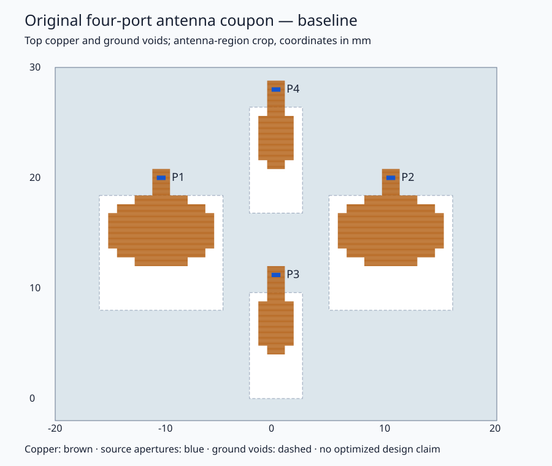
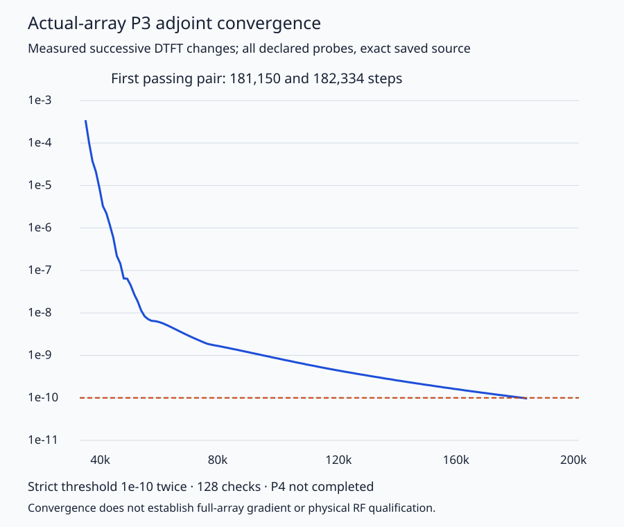

# QM33120 UWB antenna inverse-design research snapshot

This is the current **inactive research implementation and numerical simulation evidence** for
an original four-port antenna coupon. It is not an optimized antenna, an integrated
RF board, or a qualified antenna/diplexer assembly. No script here launches cloud
resources. Importing the modules does not construct the full model or run FDTD.

## Scientific state

| Item                      | Measured state                                                                                       | Limit                                                                            |
| ------------------------- | ---------------------------------------------------------------------------------------------------- | -------------------------------------------------------------------------------- |
| Baseline geometry         | Original four-port copper, fixed masks, stackup, ground voids and 50 Ω source apertures included     | Antenna coupon proxy, not chip-plane assembly                                    |
| Current objective         | Both channel bands, phase/coverage/advisory terms and four hard engineering rows                     | Circular smooth surrogate is not a certificate of raw physical delay improvement |
| Adjoint implementation    | Joint complex-field cotangents, sources, material/edge gradients and filter/projection/block-map VJP | Algebra fixtures and small native fixtures do not qualify full-array gradients   |
| Tiny native all-row check | Five rows, two directions; finer one-sided finite differences passed unchanged gates                 | Nominal η=0.5, β=16, 36 variables; original coarser failure retained in summary  |
| Actual-array P3 adjoint   | Converged at **182,334 steps**, two successive changes below **1e-10**, 10 field exports verified    | Successive DTFT change only; not independent field/phase/gradient error          |
| Actual-array P4 adjoint   | **Never completed**                                                                                  | No completed P4 adjoint or combined full-array gradient                          |
| Optimization              | Updates explicitly blocked in `UpdateLoop.step()`                                                    | No accepted optimized geometry or actual-array directional qualification         |
| QM33120 diplexer          | Loaded channel-5/9 architecture and provisional requirements                                         | No optimized channel-5/9 diplexer result or loaded full-chain validation         |

The repository's existing [8/12 GHz diplexer example](../../docs/rf/diplexer) is a
separate implementation with different bands. It is not evidence for this QM33120
channel-5/9 assembly.





## Files

- `model/inputs/spec.json`, `rho.npz`, `audit.json`: original geometry and source/grid
  identities. The 368×296 mask uses 0.1 mm cells. The surrounding finite board is
  40×80 mm. These files are not fabrication-ready KiCad/Gerber deliverables.
- `model/array_model.py`: frozen full-array construction with exact timestep,
  source, ground and grid checks. **Its historical `components`, `objective` and
  `joint` methods are superseded for current objective validation**. Use
  `jointopt.objective.JointObjective` for both current scalar finite differences
  and adjoint cotangents; do not compare different merits.
- `model/parameterization.py`: exact binary block seed and a bounded continuous
  relaxation with admissible inward one-sided directions at binary endpoints.
- `jointopt/`: current objective revision `local-observable-variation-candidate/2`,
  acceptance `local-observable-acceptance/3`, field bridge, source preparation,
  geometry chain, validation and inactive optimizer/checkpoint interfaces.
- `contracts/`: public scientific requirements projection, exact frequency construction,
  acceptance and sanitized frozen diagnostic contract. The historical contract describes
  an earlier objective; the diagnostic contract and current code identify the current
  merit. Sanitized exports are **not** substitutes for original authenticated
  runtime receipts. Native guards still reject mismatched engine identities.
- `validation/`: exact P3 post-source convergence consumer and finer directional
  comparison arithmetic. The latter requires authenticated inputs; raw arrays alone
  do not establish provenance or gradient qualification.
- `results/`: selected scientific evidence, original receipt digests and full P3
  scalar/probe history. Large raw fields, private runtime records and cloud
  orchestration are deliberately excluded. This snapshot cannot independently
  reauthenticate omitted field bytes merely from their digests.
- `source-provenance.json`: source and publication hashes, with explicit edits.

The raw phase/delay metrics remain distinct from the smooth loss. Restoration
requires componentwise non-regression and explicit observability/context checks;
newly observable support is reported separately. This conservative rule may stall.
It does not authorize compensating tradeoffs or certify unresolved delay aliases.
Projection η values are numerical test variants, **not** fabrication tolerances.

## Reproduce the bounded offline checks

Use the repository's pinned Python dependencies (`requirements.lock`), including
NumPy 1.26.4 and PyTorch 2.3.1, with a supported Python interpreter. From the repo
root, in that environment:

```sh
python examples/qm33120-inverse-design/check.py
```

The runner bounds each child to 120 seconds and one numerical thread. It evaluates
analytic complex linear-field fixtures (with a labeled synthetic normalization/persistence
envelope), map VJPs, inactive acceptance/persistence,
exact frequency identity and the saved numerical P3 convergence record. It performs
**zero native FDTD steps**, no network calls and no optimization updates. Analytic
fixture passes are labeled separately from historical native evidence.

Historical native work used Python 3.11.15, NumPy 1.26.4 and PyTorch 2.3.1. P3 used
Linux x86-64 AVX512, ABI 4 and the exact native/source hashes recorded in its result.
A current checkout passing the offline checks is not automatically equivalent to
that native runtime. Full model construction is intentionally explicit and expensive;
this example does not provide an automatic cloud or full-array solver command.

To reproduce actual native science, first bind the exact engine/native identities,
model, source normalization and recording contract, obtain complete authenticated
forward/source fields, then execute a separately bounded provider. `factory.build`
expects that verified model/provider; it does not acquire one. The native frequency
preflight preserves its original strict source hash and can reject a newer engine.
Do not remove that guard to make an environment pass.

## Next scientific gates

1. Complete the P4 adjoint with the same source/grid/normalization and convergence
   criteria; recombine both contributions with material and edge terms.
2. Validate the actual-array gradient against both frozen directional checks and
   tighter convergence using the **same** current scalar objective.
3. Review surrogate/acceptance adoption, complete parameterization and independent
   trial validation before enabling optimizer updates.
4. Validate all excitations, finer mesh, manufacturability and the loaded diplexer /
   chip reference-plane assembly. Dense delay and pulse-fidelity evidence remain open.

The original baseline remains infeasible against the full requirements. Earlier
small geometry screens did not produce an accepted improvement. This publication
preserves useful design work without converting those results into qualification.

Historical assembly netlist/stack paths mentioned in the requirements are contextual
references, not files supplied or revalidated by this snapshot. The available antenna
mask/model is included; no completed board CAD or QM33120 diplexer seed is claimed here.
