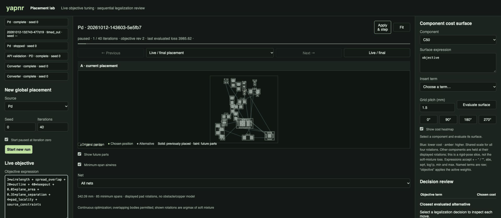
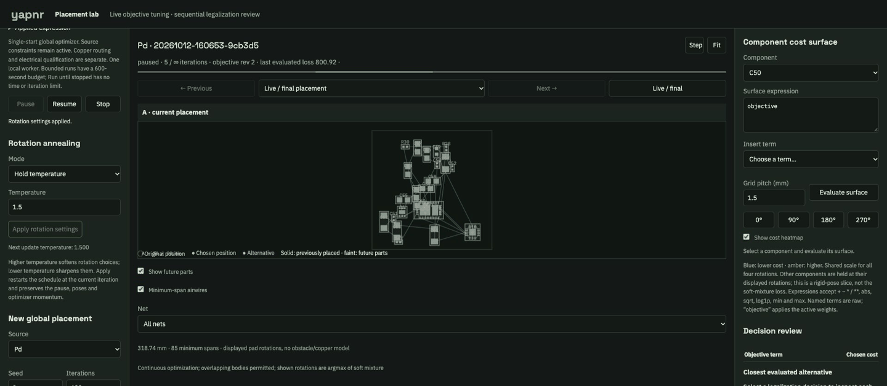
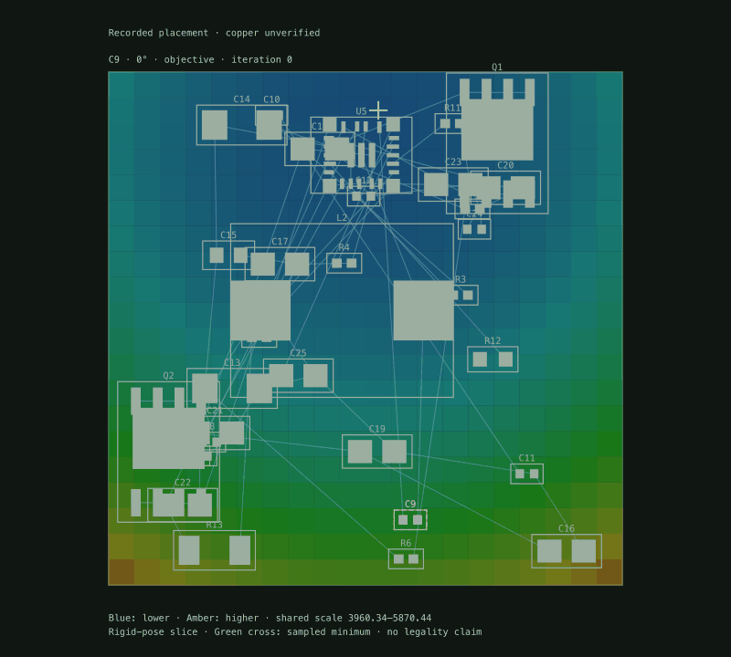

# Placement laboratory

Open `placement-lab.html` from the live viewer. The lab runs the real single-start
`pnr.place.model.global_place` optimizer locally, then the regular legalizer. It is a
placement experiment, not a route, electrical acceptance, or replacement for the
production power-first multi-start campaign. Recorded power-first A/B cases can be
reviewed in the same workspace, with their mode and seeds retained.

For agent control, use the [versioned HTTP/Python/JSON CLI API](PLACEMENT-API.md):
`yapnr placement schema` discovers its operations. Agents can drive runs, inspect
individual decisions, render actual geometry and discuss canonical notes without a browser.

## Live objective

Choose an input, seed, and iteration budget, then **Start new run**. Edit the expression
in **Live objective** and press **Apply objective** to change weights at the next
optimizer iteration boundary, without advancing a paused run. The applied revision
is shown after the worker acknowledges it. If you edit while paused, **Step** becomes
**Apply & step**: it waits for that acknowledgment, then advances exactly once.
Invalid expressions or conflicting changes from another client prevent the step.
New runs start paused at iteration zero by default (uncheck the option to run freely).
**Step** performs exactly one optimizer update and pauses again, retaining Adam state.
The board shows the post-update positions; loss is explicitly the last evaluated
(pre-update) loss. At the last iteration, **Resume** proceeds to legalization.
**Pause** preserves the optimizer state; **Resume** continues it. **Stop** retains saved
frames. A single worker uses one Torch thread. Bounded runs allow at most 5,000
iterations and 600 seconds, including pauses. Enable **Run until stopped** when
starting a run to remove both limits. It continues beyond the annealing horizon,
retaining the same Adam state; pause and stepping remain available indefinitely.
Stop saves the current frames without running legalization. Interrupted and
timed-out runs remain in the experiment list.

The DSL accepts nonnegative weighted sums of existing terms, parentheses, `+` and `*`:

```text
wirelength + 2*spread_overlap + 20*outline + 40*keepout
+ 0.05*plane_area + 0.35*plane_separation + 4*pad_locality
+ source_constraints
```

Coefficients are finite and at most 1,000. Calls, attribute access, exponentiation,
nonlinear products, and Python evaluation are unavailable. `source_constraints` must
appear exactly once: authored group/edge/relationship intent and matching remain active.
Lowering a smooth penalty never disables final hard placement checks. The expression
controls **global placement**; legalizer displacement and channel weights remain separate.
Soft rotation mixtures drive the optimizer; the board displays each mixture's most likely
cardinal rotation. Apparent collisions during optimization are not legal placements.

Every run freezes its source graph, compiled constraints, routing rules, engine Python
sources, seed, initial expression, numeric runtime versions, and settings.
`iterations.jsonl` records poses,
rotation probabilities, actual loss, and weight changes at the exact iteration where they
were consumed. A replay must apply that iteration schedule to the frozen engine; a seed
alone is insufficient after live edits. Timing and UI pacing are not optimizer inputs.
The browser shows the acknowledged objective revision rather than inferring application
from the button click.



Actual browser captures: an unsent weight edit, the acknowledged change at the same
iteration, then one optimizer update. No interpolated placement frames. A two-update
run with wirelength weights 8 then 3 exactly matches an uninterrupted replay of that
schedule, including the rotation probabilities.

## Rotation annealing

The **Rotation annealing** controls work before starting a run and during a live
run, including while paused:

- **Hold temperature** uses a fixed temperature (0.05–10).
- **Anneal over iterations** transitions linearly from the chosen start temperature
  to the end temperature over the chosen number of iterations (1–1,000,000), then
  holds the endpoint. Defaults are 2.0 to 0.2 over 400 iterations.
- **Apply rotation settings** acknowledges the change without stepping or
  unpausing. **Apply & step** also applies unsent rotation edits before advancing.
  Applying a schedule restarts it from the current iteration, even when
  its values are unchanged. This allows reheating and cooling again.

Higher temperature makes the distribution over the four rotations softer; lower
values make it sharper. This is not a random-rotation rate. Positions, learned
rotation logits and Adam momentum are preserved. The displayed temperature is for
the next update; saved board frames retain their last evaluated rotation mixture.
The iteration history records each schedule and actual evaluation temperature for
replay. These lab controls do not enable new production search defaults.



Actual browser captures at iterations 5, 6 and 11: hold at 1.5, restart a schedule
at 3.0, then reach and retain 0.3. The original three-iteration stopping setting is
ignored in unlimited mode. All eleven updates exactly match an uninterrupted replay
of the recorded temperature schedule; the initial three match the previous finite
engine's poses and rotation probabilities.

## Sequential legalization review

Use **Next**, **Previous**, or the component list to walk the accepted legalization path.
The board shows the actual decision-time context: prior placements solid, future
components faint, original pose amber, chosen pose green, and inspected alternative purple.
A/B comparison follows the same reference in the second run and shares the viewport.

Each decision displays translation, rotation, separate objective contributions and the
closest **evaluated** candidate, including its cost. The alternative menu retains the best
12 and closest four evaluated sites from each explored orientation. These are historical
candidate scores, not newly solved counterfactuals or copper-clearance predictions.
The nearest evaluated candidate is not proof of the smallest possible displacement.
Backtracking counts are retained; discarded backtracking branches are not reconstructed.

**Save comment** creates a canonical design note bound to the immutable decision hash,
run, component, poses, costs, and selected alternative. Comments survive reloads, appear
in the existing notes store, and can be read by the agent. They never approve a placement
or mutate the engine objective. Run/step/comparison links preserve the review selection.

## Sources and evidence

Global cost-capture events under the viewer's configured capture root populate source
choices automatically. Existing projects can register immutable JSON inputs under
`<live>/placement-lab/sources/<id>.json` with `title`, neutral `graph`, dataclass-serialized
compiled `constraints`, and optional compiled `rules`. The lab does not accept arbitrary
filesystem paths from the browser. Capture documents and candidate arrays are checked
against their content hashes before review.

New live runs also register in the workspace experiment/artifact index. A placement
pass there means the hard placement checks passed, never electrical acceptance.

Runs live under `<live>/placement-lab/runs/<id>/`. `request.json`, `input.json`, `engine/`,
`control.json`, `iterations.jsonl`, `status.json`, `frame.json`, `continuous.json`,
`placed.json`, and `captures/` preserve the experiment. `review.json` indexes the chosen
legalizer's decisions and whole-board translation/rotation metrics. Failed trials stay
visible. Mutations require an allowlisted browser Origin, as design notes do.

Pad locality defaults on (`PNR_PAD_LOCALITY=0` disables it). It associates
both terminals of an unambiguous small part with the matching physical pads of its IC,
rather than its centroid or a high-fanout net bounding box. Shared rails and a broad
hierarchy group alone do not establish ownership. Explicit pad groups and private
connections can establish it. Duplicate pad shapes remain alternatives. Independent
proximity reports without engineering thresholds remain **unqualified**.

## Minimum-span airwires

The enabled-by-default overlay computes a Euclidean minimum spanning tree per net
from the displayed rotated pad centers. Select a net to isolate it and see its
total span; all nets, including rails, are included. Repeated physical pads of one
logical terminal use the closest endpoint. Missing pins are reported, never invented.
Trees update after each optimizer step and follow the chosen pose in decision review.
They do not represent routed copper, obstacle-aware paths, or the optimizer’s smooth
wirelength loss. Soft rotation mixtures can produce different objective geometry
from these displayed cardinal rotations. SVG exports include the same overlay.

## Four-rotation cost surfaces

Select a component in the right panel or click its footprint, enter a **Surface
expression**, and press **Evaluate surface**. Flip between **0° / 90° / 180° / 270°**
without recomputing. Blue means lower cost, amber higher; all four maps share a
color scale. The sampled minimum and its location are shown for each rotation.
Use a 0.5–5 mm pitch, at most 1,600 samples per rotation. One read-only worker
has a 60-second budget. Requests and results are recorded as discovery experiments.

`objective` applies the active live weights; other named terms expose their raw
whole-board values. `source_constraints` retains authored rule weights and matching.
The surface expression supports finite numbers, named terms, `+ - * / **`,
parentheses, `abs`, `sqrt`, `log1p`, `min`, and `max`; powers are limited to 0–4.
It does not execute Python. Non-finite results are rejected. Examples:

```text
spread_overlap
wirelength + 8*pad_locality
objective - 0.5*wirelength
max(outline, 10*keepout)
```

Surface edits are read-only. To tune the optimizer, change the left-hand **Objective
expression** and **Apply objective**; its stricter nonnegative linear DSL preserves
source constraints. Heatmaps use the frozen frame's other components at their
**displayed cardinal rotations**, not their soft rotation mixtures. They evaluate
absolute whole-board cost; shared costs are not divided into misleading local shares.
They are sampled counterfactual slices, not legal sites or native DRC. Fixed parts'
fields are hypothetical. Moving the optimizer makes a surface stale and hides it
until evaluated again. The request pins geometry, weights and frozen engine sources.



The animation switches four computed slices of one frozen seed-zero initial
converter placement. It is a rotation comparison, not an optimizer trajectory.

Changing the applied objective also marks existing heatmaps stale, even when the
placement has not moved. Evaluate again to see the updated weights.
